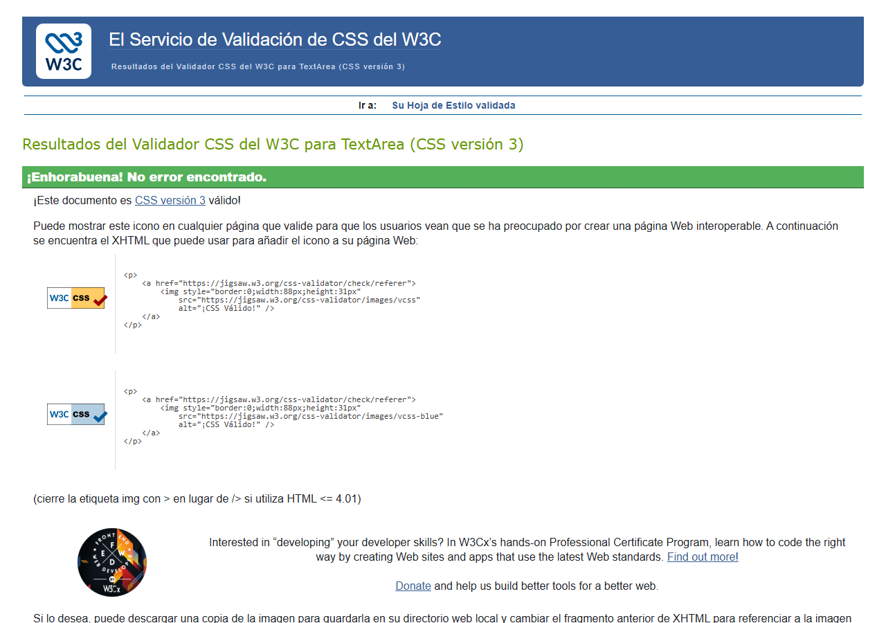
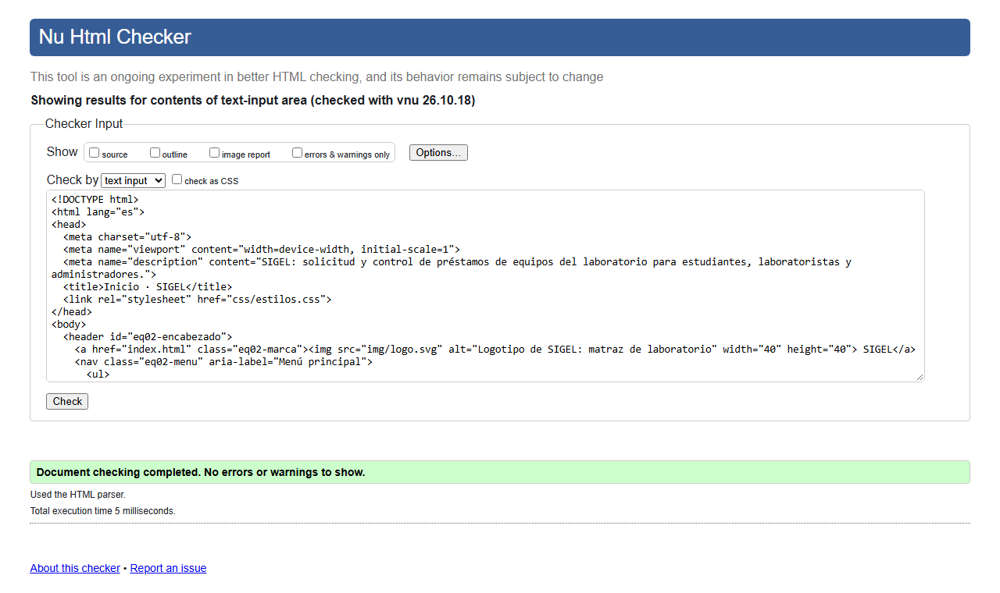
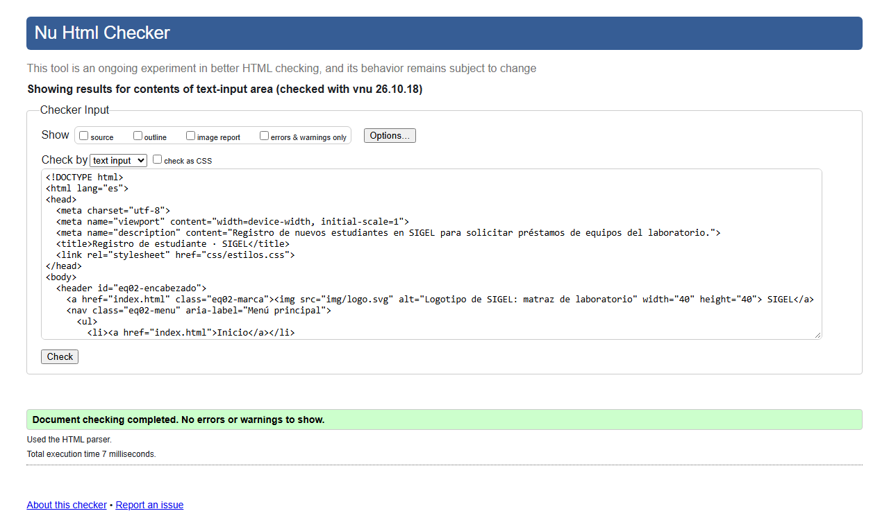
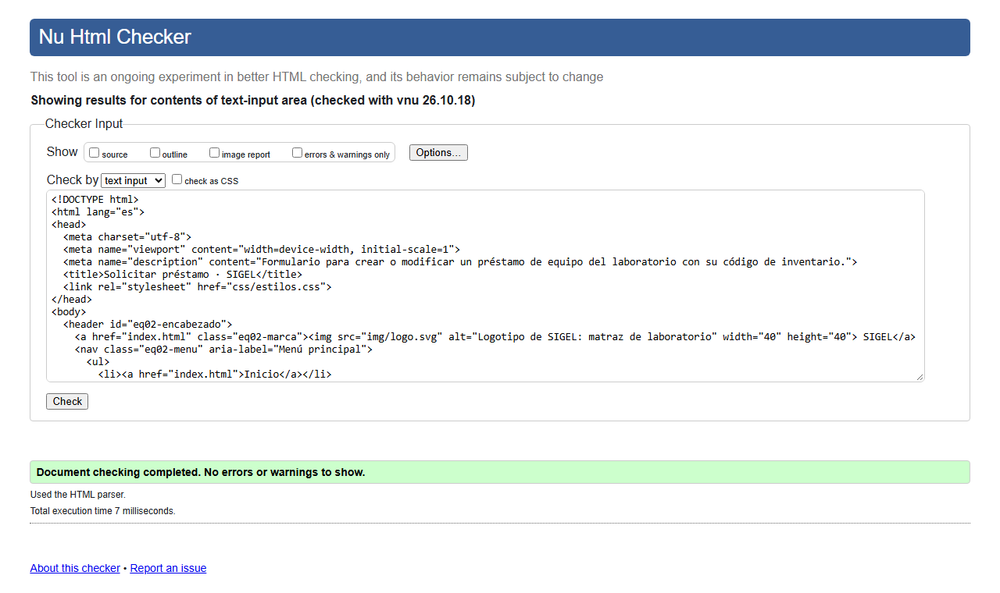
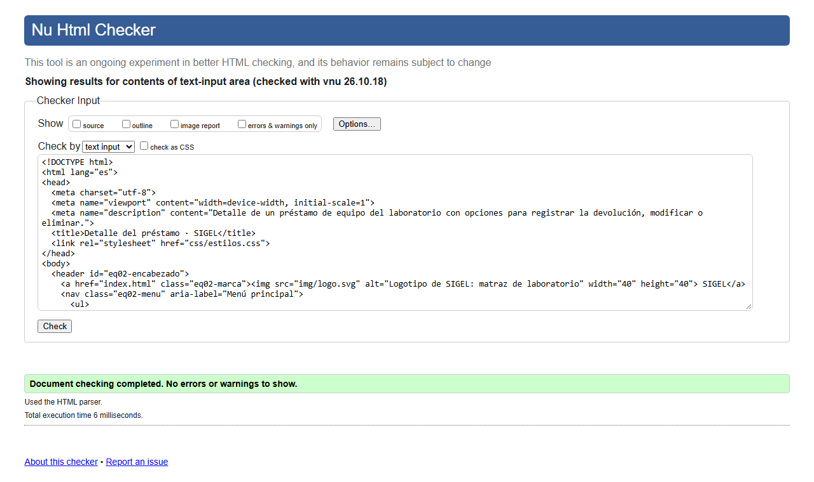
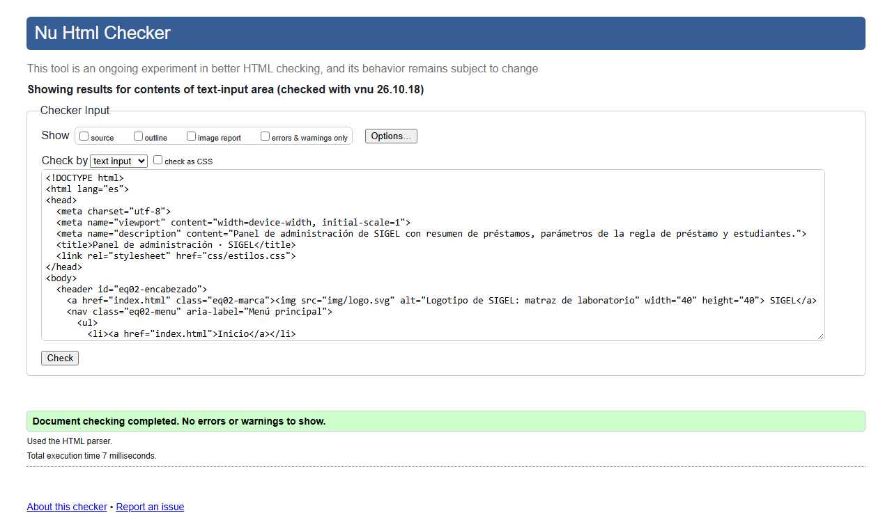

# SIGEL · Sistema de Gestión de Préstamos de Equipos del Laboratorio

Equipo 02 · Desarrollo Web · Hito #1 (Entrega final)

## Integrantes y roles del hito

| Integrante | Usuario GitHub | Rol |
|------------|----------------|-----|
| Ariel Jimenez | [arieljimenezthx-glitch](https://github.com/arieljimenezthx-glitch) | Líder de proyecto y repositorio · Desarrollo HTML5/CSS3 |
| Alejandro Saenz | [Alejo50716](https://github.com/Alejo50716) | Diseño y experiencia de usuario · Calidad, seguridad y documentación |

## Descripción

SIGEL reemplaza la hoja de papel con la que hoy se prestan los equipos del laboratorio (osciloscopios, multímetros, kits, routers y laptops). El estudiante solicita el préstamo en línea, el laboratorista sabe quién tiene cada equipo y cuándo debe devolverlo, y el administrador gestiona el inventario y los parámetros de préstamo.

## Cómo abrir el sitio

Abrir `index.html` en el navegador. Es una maqueta estática HTML5 + CSS3, sin JavaScript ni servidor.

## Personalización asignada

| Elemento | Valor | Dónde se aplica |
|----------|-------|-----------------|
| Prefijo | `eq02-` | Todas las clases e `id` de estilo (`#eq02-encabezado`, `.eq02-boton`, `.eq02-campo`…) |
| Color de acento | `#0B6E4F` | Encabezado, botones, enlaces, `legend` y encabezados de tabla. Guía de estilo al inicio de `css/estilos.css` |
| Campo especial | Código de inventario: 3 letras, guion y 5 números (ej. `RED-00123`) | `principal-formulario.html` (`#eq02-bloque-equipo`): `<input type="text" name="codigo_inventario" pattern="[A-Z]{3}-[0-9]{5}" minlength="9" maxlength="9" required>`. También en `secundaria-formulario.html` |
| Regla de negocio | Máximo 3 equipos prestados a la vez (un kit cuenta como uno; cables y accesorios no cuentan). Cada préstamo dura máximo 3 días y quien tenga un préstamo vencido no puede solicitar otro. Cantidad y días configurables. | `index.html` (reglas), `principal-formulario.html` (tipo de ítem, fecha de devolución con `max`, `<meter>` de 2 de 3), `principal-listado.html` y `principal-detalle.html` (estado *Vencido* y aviso de bloqueo), `panel.html` (tabla "¿Puede solicitar?" y formulario de parámetros `max_equipos` y `max_dias`), `perfil.html` |

HTML solo puede exigir el formato del código (`pattern`) y limitar fechas (`min`/`max`). Contar los equipos prestados, calcular los 3 días y detectar vencidos se validará en PHP (Hito #2) con los datos de MySQL (Hito #3).

## Páginas

| Archivo | Pantalla | Rol |
|---------|----------|-----|
| `index.html` | Inicio con accesos por rol y reglas de préstamo | Todos |
| `login.html` | Inicio de sesión (formulario 1) | Todos |
| `registro.html` | Registro de estudiante (formulario 2) | Estudiante |
| `recuperar.html` | Recuperación de contraseña (formulario 3) | Todos |
| `principal-formulario.html` | Crear / modificar préstamo (formulario 4, entidad principal) | Estudiante, laboratorista |
| `principal-listado.html` | Listado de préstamos con búsqueda y filtros (tabla 1) | Laboratorista |
| `principal-detalle.html` | Detalle, registrar devolución, modificar y eliminar | Laboratorista |
| `secundaria-formulario.html` | Crear y listar equipos (formulario 5 y tabla 2, segunda entidad) | Administrador |
| `panel.html` | Resumen, estudiantes con préstamos (tabla 3) y parámetros de la regla | Administrador |
| `perfil.html` | Datos del estudiante y préstamos activos | Estudiante |

## Cumplimiento técnico

- Estructura base en las 10 páginas: `<!DOCTYPE html>`, `lang="es"`, `charset`, `viewport`, `<title>` único y `meta description`.
- Semántica: `header`, `nav`, `main`, `section`, `article`, `aside`, `footer`; un solo `h1` por página y niveles en orden.
- Texto: `ul`, `ol`, `dl`, `figure`/`figcaption`, `strong`, `em`, `time`, `abbr`, `code`, `meter`.
- Tablas: 3 tablas con `caption`, `thead`, `tbody`, `th scope="col"` y `th scope="row"`; la de préstamos tiene `tfoot`.
- Imágenes SVG con `alt`, `width` y `height` en `img/`.
- Formularios: `method="post"`, `action="#"`, `label for`/`id` en cada campo, `fieldset`/`legend` y atributos `required`, `placeholder`, `minlength`, `maxlength`, `pattern`, `min`, `max`, `step`, `autocomplete` y `name`. 13 tipos de entrada: `text`, `email`, `password`, `tel`, `date`, `time`, `datetime-local`, `number`, `search`, `url`, `file`, `checkbox`, `radio`.
- Los `name` serán columnas en el Hito #3: `codigo_inventario`, `cedula_estudiante`, `fecha_prestamo`, `fecha_devolucion`, `id_laboratorio`, `tipo_item`…
- CSS: una hoja externa `css/estilos.css`, sin estilos en línea. Selector universal (`*`), de agrupación (`h1, h2, h3`), de clase (`.eq02-boton`) y de id (`#eq02-encabezado`), Flexbox, Grid y `@media (max-width: 760px)` para móvil.
- Navegación: el menú del encabezado y el mapa del sitio del pie enlazan las 10 páginas desde cualquier página.

## Validación W3C

Resultado del 19/10/2026 con el Nu HTML Checker y el CSS Validation Service (perfil CSS3):

| Archivo | Errores | Advertencias |
|---------|---------|--------------|
| index.html | 0 | 0 |
| login.html | 0 | 0 |
| registro.html | 0 | 0 |
| recuperar.html | 0 | 0 |
| principal-formulario.html | 0 | 0 |
| principal-listado.html | 0 | 0 |
| principal-detalle.html | 0 | 0 |
| secundaria-formulario.html | 0 | 0 |
| panel.html | 0 | 0 |
| perfil.html | 0 | 0 |
| css/estilos.css | 0 | 0 |

### Capturas del validador

**CSS** (`css/estilos.css`, perfil CSS3)

**HTML** (cada página en el modo de entrada de texto del Nu HTML Checker)

| Página | Captura |
|--------|---------|
| index.html |  |
| login.html |  |
| registro.html |  |
| recuperar.html |  |
| principal-formulario.html |  |
| principal-listado.html |  |
| principal-detalle.html |  |
| secundaria-formulario.html |  |
| panel.html |  |
| perfil.html |  |

## Documentos

- `docs/propuesta.pdf`: propuesta del sistema (problema, roles y permisos, historias de usuario, requerimientos, entidades, benchmark, OWASP y plan de trabajo).
- `docs/wireframes.pdf`: wireframes de las 10 pantallas, 4 versiones móviles, anotaciones y flujo de navegación por rol.
- `docs/guia_estilo.pdf`: paleta, tipografías, componentes y contraste.
- `docs/matriz_responsabilidades.pdf`: tareas con responsable, revisor, fecha y estado.
- `docs/usabilidad.pdf`: resultados de la prueba de usabilidad del 20/10/2026 (3 personas, 3 tareas, 9 de 9 completadas) y los 2 cambios al diseño aplicados en teléfono y cédula. `docs/usabilidad.md` es la versión editable.
- `docs/bitacora.md`: bitácora de las sesiones de trabajo.

## Declaración de herramientas

- Editor: Visual Studio Code. Navegador: Google Chrome. Control de versiones: Git y GitHub.
- Validadores: W3C Nu HTML Checker y W3C CSS Validation Service.
- Se uso Claude para tener una buena organizacion general y un progreso ordenado 
